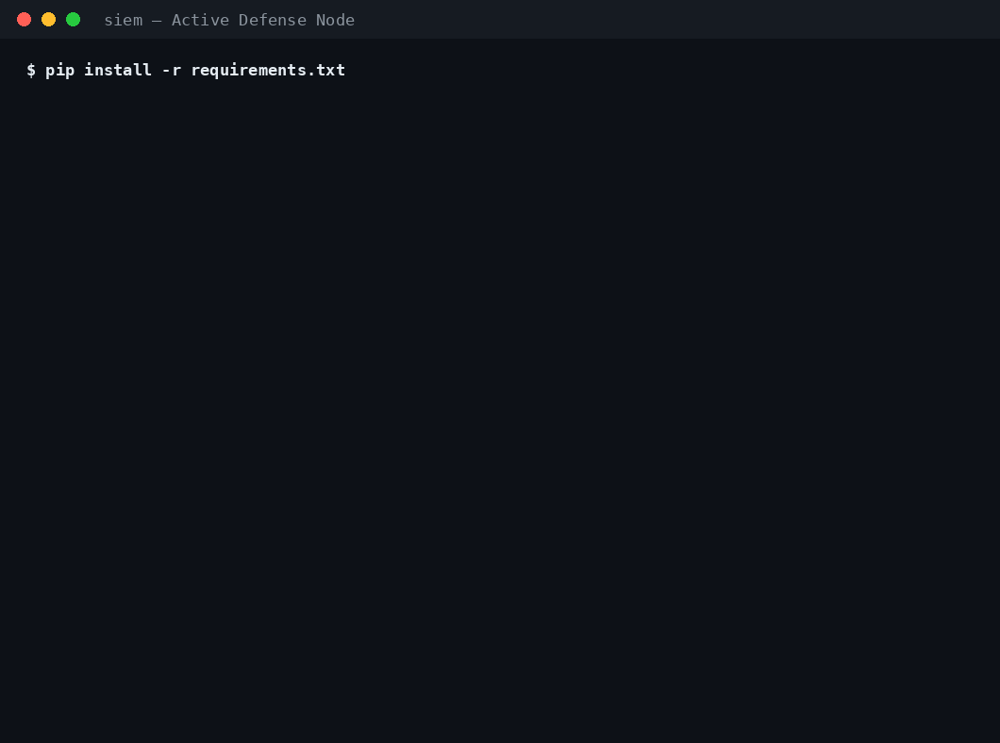
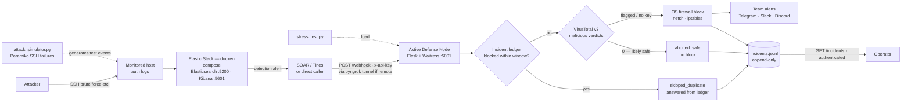

# Automated Threat Hunting & Incident Response Pipeline

[](https://github.com/Manoj-2424150118/SIEM/actions/workflows/ci.yml)


**Repository:** [github.com/Manoj-2424150118/SIEM](https://github.com/Manoj-2424150118/SIEM)

<p align="center"></p>

---

## Quickstart

```bash
git clone https://github.com/Manoj-2424150118/SIEM.git
cd SIEM
cp .env.example .env            # then fill in your keys
pip install -r requirements.txt
docker compose up -d            # Elasticsearch :9200 · Kibana :5601
python webhook_listener.py      # Active Defense Node on :5001
```

On Windows, `start_siem.bat` performs the whole sequence in one click. Full detail under [Setup & run](#setup--run).

## Overview

This project is a closed-loop **SIEM → SOAR active-defense pipeline**. Detection events arrive from the Elastic Stack (or a SOAR platform such as Tines, via webhook), and the **Active Defense Node** (`webhook_listener.py`) closes the loop:

1. **Authenticate** the webhook (`x-api-key`) and validate the reported IP.
2. **Check the incident ledger first** — if the IP was already blocked within the suppression window (default 24 h), the repeat is answered from the ledger alone: no VirusTotal quota burned, no firewall churn, no duplicate team alert.
3. **Verify against VirusTotal** — if the IP's VirusTotal record shows zero malicious verdicts, the block is *aborted* as a likely false positive. Threat intelligence gets a veto over the firewall.
4. **Block at the OS firewall** — `netsh` on Windows, `iptables` on Linux (the node is OS-aware).
5. **Alert the team** — rich incident reports to Telegram, Slack or Discord.
6. **Record everything** — every decision (`blocked`, `skipped_duplicate`, `aborted_safe`, `error`) is appended to a persistent JSONL incident ledger that survives restarts and is queryable through the authenticated `GET /incidents` endpoint. Even failure paths record an `error` decision — a failed block is never silently invisible.

Supporting tooling ships in the same repo: an **attack simulator** that generates real SSH authentication failures (Paramiko) to exercise the detection chain end-to-end, a **stress tester** for concurrent webhook load, and a **tunnel helper** (pyngrok) to expose the local node to a cloud SOAR.

Built by [Manoj Kumar Sharma](https://github.com/Manoj-2424150118) — Cybersecurity & Software Professional (MCA, Manipal University Jaipur).

---

## Architecture



Components:

| Component | File | Role |
|---|---|---|
| Active Defense Node | `webhook_listener.py` | Flask app served by Waitress on :5001 — webhook auth, ledger dedupe, VirusTotal verification, firewall enforcement, team alerts |
| Incident ledger | `incident_ledger.py` | Append-only JSONL store (`IncidentLedger`) — decision history, `was_blocked_within` dedupe queries, env-configured path + window; torn lines tolerated |
| SIEM backend | `docker-compose.yml` | Elasticsearch 8.15.0 (:9200) + Kibana (:5601), single-node |
| Attack simulator | `attack_simulator.py` | Paramiko SSH brute-force simulation that produces genuine auth failures for the pipeline to detect |
| Stress tester | `stress_test.py` | Concurrent webhook load against the node |
| Tunnel helper | `start_tunnel.py` | pyngrok tunnel so a cloud SOAR (Tines) can reach the local node |
| Launcher | `start_siem.bat` | Windows 1-click: installs dependencies, starts Elastic, launches the node |

---

## Threat model

| Assets | Adversaries | Mitigations |
|---|---|---|
| The host firewall itself — the node can add block rules, so its API is a high-value control plane | Unauthenticated callers attempting to make the node block arbitrary IPs (denial of service by firewall) | Every route requires the `x-api-key` header (`WEBHOOK_API_KEY`); if no key is configured, the node generates a strong random one on first run and stores it in `.env` — it never runs unauthenticated by default |
| Legitimate IPs that must never be blocked | Spoofed or over-eager detection events; false-positive alerts | VirusTotal verification before enforcement: an IP with zero malicious verdicts aborts the block (`aborted_safe`); IP format is validated before any processing |
| VirusTotal quota & firewall stability | Repeat floods of the same attacker IP | The ledger answers duplicates inside the suppression window (default 24 h, `SIEM_DEDUPE_WINDOW_HOURS`) before any external call or firewall work — no quota burn, no rule churn, no duplicate alerts |
| Incident history (the node's memory) | Crashes, restarts, partial writes | Append-only JSONL on disk (`SIEM_INCIDENTS_PATH`), tolerant of torn lines; decisions are recorded on **all** paths — success, duplicate, aborted, and error |
| Alert channels & API keys | Anyone reading the repo or a leaked config | All secrets live in `.env` (git-ignored), never in code; `.env.example` documents names only |
| The exposed webhook (when tunnelled) | Internet scanners hitting the pyngrok URL | The same `x-api-key` authentication applies through the tunnel; the tunnel is an operator-run helper, started deliberately, not by default |

**Out of scope / honest limitations:** the node enforces blocks — it is not itself a detection engine (detection lives in Elastic/SOAR rules); the bundled Elasticsearch compose runs single-node with X-Pack security disabled, which is a local-lab configuration, not a production hardening guide; firewall changes require elevation (Administrator on Windows, root/CAP_NET_ADMIN on Linux), and in a container without that capability the node records an `error` decision rather than pretending the block happened.

---

## Tech stack

| Layer | Technology |
|---|---|
| Defense node | Python 3.10 · Flask 3.1.3 · Waitress 3.0.1 (WSGI) |
| SIEM backend | Elasticsearch 8.15.0 · Kibana 8.15.0 (Docker Compose) |
| Threat intelligence | VirusTotal API v3 |
| Enforcement | Windows Firewall (`netsh advfirewall`) · Linux `iptables` |
| Alerts | Telegram Bot API · Slack incoming webhooks · Discord webhooks |
| Simulation & load | Paramiko 5.1.0 (SSH) · pyngrok 7 (tunnels) · `requests` |
| Config | `python-dotenv` — all keys via `.env` |
| Tests & CI | `pytest` — GitHub Actions on `windows-latest`, Python 3.10 |

---

## Setup & run

**Prerequisites:** Python 3.10+; Docker (for the Elastic Stack); Administrator (Windows) or root/CAP_NET_ADMIN (Linux) rights for firewall changes.

```bash
git clone https://github.com/Manoj-2424150118/SIEM.git
cd SIEM
cp .env.example .env        # Windows: copy .env.example .env — then fill in your keys
pip install -r requirements.txt
docker compose up -d        # Elasticsearch on :9200, Kibana on :5601
python webhook_listener.py  # Active Defense Node (Waitress) on :5001
```

On Windows, `start_siem.bat` performs the whole sequence in one click.

- **Kibana:** http://localhost:5601 · **Elasticsearch:** http://localhost:9200
- **Webhook:** `POST http://localhost:5001/webhook` with header `x-api-key: <your WEBHOOK_API_KEY>` and JSON body `{"ip": "203.0.113.10"}`.
- **Incident history:** `GET http://localhost:5001/incidents` with the same header.
- To receive events from a cloud SOAR, expose the node with `python start_tunnel.py` (needs `NGROK_AUTH_TOKEN`) and register the tunnel URL in your SOAR (e.g. Tines).

### Configuration (`.env`)

| Variable | Purpose |
|---|---|
| `WEBHOOK_API_KEY` | Authenticates SOAR → node calls. If left blank, a secure key is auto-generated on first run and written to `.env` |
| `VIRUSTOTAL_API_KEY` | Enables the false-positive veto (block aborted when VT shows 0 malicious verdicts) |
| `SIEM_DEDUPE_WINDOW_HOURS` | Duplicate-suppression window (default `24`) |
| `SIEM_INCIDENTS_PATH` | Ledger location (default `incidents.jsonl` next to `webhook_listener.py`) |
| `TELEGRAM_BOT_TOKEN` · `TELEGRAM_CHAT_ID` | Telegram incident alerts |
| `SLACK_WEBHOOK_URL` · `DISCORD_WEBHOOK_URL` | Slack / Discord incident alerts |
| `NGROK_AUTH_TOKEN` | Only for `start_tunnel.py` |

### Exercise the pipeline

```bash
python attack_simulator.py    # generate real SSH auth failures against a target you own
python stress_test.py         # concurrent webhook load against the node
```

---

## Testing

```bash
python -m pytest tests/ -q
```

| Test file | Covers |
|---|---|
| `tests/test_webhook.py` | Webhook auth, IP validation, VirusTotal veto, block decisions, and the error paths — failed/unsupported firewall outcomes are recorded in the ledger as `error` decisions |
| `tests/test_incident_ledger.py` | Ledger append/read, dedupe-window logic, torn-line tolerance, env configuration |
| `tests/test_attack.py` | Attack-simulator behaviour |

CI (**SIEM Pipeline Tests**) runs the suite on every push/PR on `windows-latest` — the node's primary firewall target — with Python 3.10. Platform-dependent cases skip cleanly where the OS or elevation isn't available.

---

## Project structure

```
├── webhook_listener.py    # Active Defense Node — Flask/Waitress API (:5001)
├── incident_ledger.py     # Append-only JSONL incident ledger + dedupe window
├── attack_simulator.py    # Paramiko SSH brute-force simulator (test events)
├── stress_test.py         # Concurrent webhook load tester
├── start_tunnel.py        # pyngrok tunnel helper for cloud SOAR integration
├── start_siem.bat         # Windows 1-click launcher
├── docker-compose.yml     # Elasticsearch + Kibana (8.15.0)
├── requirements.txt       # Flask, Waitress, Paramiko, pyngrok, requests, python-dotenv
├── .env.example           # Every supported key, documented
├── tests/                 # pytest suite (webhook, ledger, attack simulator)
├── .github/workflows/     # CI — windows-latest, Python 3.10
└── LICENSE                # MIT
```

---

## Security

**Please report vulnerabilities privately**, following the maintainer's security policy in **[SECURITY.md](SECURITY.md)** (GitHub private vulnerability reporting) — not via a public issue. This project operates a firewall control plane, so reports about authentication bypasses or unintended rule changes are especially valuable — and exactly the kind that should never be filed publicly.

Standing cautions: run the node with a strong `WEBHOOK_API_KEY` (it can modify your firewall), think before tunnelling it to the public internet, and only ever aim `attack_simulator.py` at systems you own.

## Author

**Manoj Kumar Sharma** — Cybersecurity & Software Professional · Jaipur, India
MCA, Manipal University Jaipur · EC-Council Ethical Hacking Essentials · Google Cybersecurity Professional Certificate
Other work: [Aegis Cyber Defense Platform](https://github.com/Manoj-2424150118/aegis-cyber-defense-platform) · [Deceptive-Net](https://github.com/Manoj-2424150118/Deceptive-Net-A-Honey-Token-Generative-Framework) · [Portfolio](https://manoj-2424150118.github.io)

## License

MIT — see [LICENSE](LICENSE).
