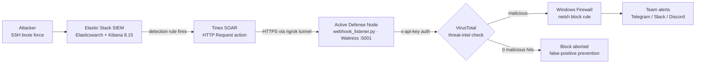

# Automated Threat Hunting & Incident Response Pipeline

[](https://github.com/Manoj-2424150118/SIEM/actions/workflows/ci.yml)


This project implements a fully automated, closed-loop SIEM to SOAR pipeline designed for real-world environments. When an attacker attempts a brute-force or malicious action, the system automatically detects the threat, verifies the IP natively against Threat Intelligence (VirusTotal) to prevent false positives, actively blocks the attacker using Windows Firewall, and alerts the security team via Telegram/Slack/Discord.

## 🌟 Key Features

1. **Automated Docker SIEM Setup**: 1-click deployment of an Elastic Stack (Elasticsearch & Kibana) using Docker Compose.
2. **Production-Ready Active Defense Node**: A hardened Waitress-based WSGI Python server (`webhook_listener.py`) serving as a local API to orchestrate firewall rules.
3. **Secure API Key Authentication**: Rejects unauthorized access attempts natively.
4. **Stress Tested Load Balancing**: Safely queues concurrent tasks to prevent the Windows Firewall (`netsh`) from crashing under heavy botnet traffic.
5. **Secure Public Tunneling**: Automatically exposes the local node to the cloud (Tines) using a secure Pyngrok tunnel.
6. **Native Threat Intelligence**: Directly integrates with the VirusTotal API inside the Python webhook to abort blocks on safe IPs (False Positive prevention).
7. **Automated Team Alerts**: Dispatches rich, Markdown-formatted incident reports to Telegram, Slack, or Discord the moment an IP is successfully blocked.

---

## ⚡ Quick Start

**Prerequisites:** Windows with Administrator rights (required to add `netsh`
firewall rules), Python 3.10+, and Docker Desktop running.

```bash
git clone https://github.com/Manoj-2424150118/SIEM.git
cd SIEM
copy .env.example .env   # then fill in your keys — see the setup guide below
```

Then either double-click `start_siem.bat` (1-click: installs dependencies, starts
the Elastic Stack, and launches the Active Defense Node), or start the pieces
manually:

```bash
docker compose up -d        # Elasticsearch on :9200, Kibana on :5601
pip install -r requirements.txt
python webhook_listener.py  # Active Defense Node (Waitress) on :5001
```

- **Kibana:** <http://localhost:5601> · **Elasticsearch:** <http://localhost:9200>
- **Webhook endpoint:** `POST /webhook` with an `x-api-key` header (see *Linking the SOAR* below)

For the full walkthrough — `.env` keys, exposing the webhook with ngrok, and wiring
up Tines — follow the **1-Click Setup Guide** further down.

---

## 🏗️ Architecture



| Component | Role |
| --- | --- |
| Elastic Stack (`docker-compose.yml`) | Ingests and indexes logs; Kibana dashboards and detection rules spot the brute force |
| Tines (SOAR) | Turns a detection into an authenticated `POST /webhook` call carrying the attacker IP |
| `start_tunnel.py` | Exposes the local node to Tines through a secure Pyngrok tunnel |
| `webhook_listener.py` | Validates the API key and IP, checks VirusTotal, queues concurrent block requests so `netsh` isn't overwhelmed, adds the firewall rule, and sends team alerts |
| `attack_simulator.py` / `stress_test.py` | Generate a realistic SSH brute force, and 50 concurrent block requests, for testing |

---

## 🛠️ Project Structure

- `start_siem.bat`: 1-click execution script that installs dependencies, spins up Docker, and launches the Active Defense node.
- `start_tunnel.py`: Initializes the Pyngrok secure cloud tunnel.
- `webhook_listener.py`: The core Active Defense Node that processes blocks, checks VirusTotal, and sends Team Alerts.
- `attack_simulator.py`: Simulates SSH brute force attacks to trigger SIEM detection rules.
- `stress_test.py`: Fires 50 concurrent authenticated requests to benchmark the server's load-handling capabilities.
- `docker-compose.yml`: Local Elastic SIEM infrastructure.
- `tests/`: pytest suite for the webhook listener and attack simulation (run in CI on every push).

---

## 🚀 1-Click Setup Guide

### 1. Configure the `.env` file
Create a `.env` file in the root directory. You will need to provide the following API keys:
```env
# Required for SOAR authentication (Auto-generated on first run if missing)
WEBHOOK_API_KEY=your_generated_secret_key

# Phase 5: Tunneling (Get from ngrok.com)
NGROK_AUTH_TOKEN=your_ngrok_token

# Phase 6: Threat Intelligence (Get from virustotal.com)
VIRUSTOTAL_API_KEY=your_virustotal_token

# Phase 7: Team Alerts (Optional)
TELEGRAM_BOT_TOKEN=your_telegram_bot_token
TELEGRAM_CHAT_ID=your_telegram_chat_id
# SLACK_WEBHOOK_URL=https://...
# DISCORD_WEBHOOK_URL=https://...
```

### 2. Start the Environment
If you are on Windows, simply double click the `start_siem.bat` file! 
This script will request Administrator privileges (required to modify the Windows firewall), verify your Python installation, automatically install all requirements, start the Elastic docker containers, and launch the Active Defense Node in a new window.

### 3. Expose the Webhook
Run the tunneling script to securely expose your Webhook to the public internet so cloud-based SOARs (like Tines) can reach it:
```bash
python start_tunnel.py
```
Copy the generated `https://xyz.ngrok-free.app` URL.

---

## 🔗 Linking the SOAR (Tines)

1. Sign up for Tines Community Edition.
2. Drag an **HTTP Request** action onto your Storyboard. 
3. Configure it to point to your Active Defense Node:
   - **URL**: `https://<YOUR_NGROK_URL>/webhook`
   - **Method**: POST
   - **Headers**: `x-api-key: YOUR_WEBHOOK_API_KEY`
   - **Payload**: `{"ip": "<<event.body.source.ip>>"}`

When Tines triggers, it will hit your local Python server. The Python server will automatically query VirusTotal, verify the IP is malicious, block it in the Windows Firewall, and send you a Telegram alert!

## 🧪 Testing

Run the automated test suite (the same one CI runs on every push):
```bash
pip install pytest requests
python -m pytest tests/
```
Some webhook tests are skipped unless you run as Administrator, since they add real
Windows Firewall rules.

Simulate an SSH brute force (Paramiko, using a real-world IoT-botnet password
dictionary) to trigger the SIEM detection rules:
```bash
python attack_simulator.py --target 127.0.0.1 --user root --count 10
```

To stress test the Active Defense Node with 50 concurrent authenticated block
requests:
```bash
python stress_test.py
```